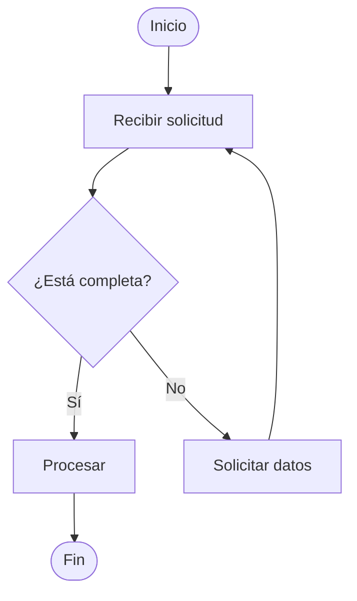

# Diagramas de Proceso

Editor local de diagramas de flujo y mapas de proceso para procesos operativos. Está hecho con React, TypeScript, Vite y React Flow, y guarda los diagramas en el navegador.

## Puesta en marcha

Requiere Node.js 18 o superior.

```bash
npm install
npm run dev
```

Abre la dirección que muestra Vite (normalmente `http://localhost:5173`).

Para generar la versión de producción:

```bash
npm run build
npm run preview
```

## Funciones

- Lienzo con zoom, desplazamiento, minimapa y ajuste automático de vista.
- Nodos de inicio/fin, proceso, decisión y acción destacada.
- Conexiones ortogonales con flecha y etiquetas editables (Sí / No).
- Selección múltiple con recuadro (botón **Seleccionar varios** o `Mayús` + arrastrar) y arrastre del grupo.
- Edición de texto con doble clic y panel de propiedades para texto, tipo y colores.
- Varios diagramas con autoguardado en `localStorage`.
- Exportación a PNG (fondo oscuro, blanco o transparente) y JSON, e importación de JSON.
- Deshacer y rehacer.
- Conversión de diagramas Mermaid a diagramas editables, con distribución automática.
- Sección de **mapas de proceso** con jerarquía proceso → subproceso → actividad, lienzo blanco, texto negro y líneas rectas sin color.

## Conversión desde Mermaid

Hay dos formas de crear un diagrama a partir de código Mermaid:

- Botón **Mermaid** en la barra superior: abre un cuadro de diálogo para pegar el código.
- Botón **Importar**: acepta archivos `.mmd`, `.mermaid` y `.txt` con código Mermaid, además del JSON exportado por la app.

El diagrama se crea como uno nuevo (no sobrescribe los existentes) y se distribuye automáticamente con dagre. Se admiten `flowchart`/`graph` con direcciones `TD`/`TB`/`BT`/`LR`/`RL`, formas `[]`, `()`, `{}`, `([])`, `(())`, `{{}}`, `[[]]`, `[()]`, `[/ /]`, flechas `-->`, `---`, `-.->`, `==>` con etiquetas en `-->|Sí|` o `-- Sí -->`, cadenas `A --> B --> C`, varios orígenes con `&` y enlaces invisibles `~~~` (solo influyen en la distribución, no se dibujan).

Limitaciones conocidas: los `subgraph` se aplanan, se ignoran `classDef`, `class`, `style` y `linkStyle` (los colores de Mermaid no se aplican) y cada aviso de este tipo aparece indicado con su número de línea. Las etiquetas de nodo y de arista se copian tal cual.



## Mapas de proceso

El selector **Flujo / Mapas** de la barra superior cambia de sección. La sección **Mapas** sirve para crear diagramas jerárquicos como los mapas de procesos:

- **N1 Proceso**: figura en forma de flecha.
- **N2 Subproceso**: recuadro rectangular que depende de un proceso.
- **N3 Actividad**: recuadro rectangular que depende de un subproceso.

Selecciona un nodo en el lienzo o en la lista **Estructura** y usa los botones de la izquierda o del inspector para añadir el nivel siguiente, hermanos o cambiar el orden. El texto se edita con doble clic o desde el inspector.

Los nodos se distribuyen automáticamente al principio, pero puedes **arrastrarlos** para acomodarlos y usar los **tiradores** del nodo seleccionado para cambiar su ancho y alto. En cuanto mueves o redimensionas un nodo, la distribución automática se fija y el resto conserva su posición. El texto se ajusta al tamaño de la figura. Con **Ctrl** o **Mayús** + clic seleccionas varios nodos y puedes arrastrarlos juntos; **Supr** elimina la selección completa. Los tiradores de tamaño aparecen al seleccionar un único nodo. Todos los elementos usan blanco, negro y líneas rectas, sin colores. El botón **PNG** exporta la imagen con fondo blanco y **JSON** permite guardar o importar los mapas.

El botón **Mermaid** crea un mapa a partir de un flowchart pegado en el diálogo: la raíz pasa a ser proceso, sus hijos subprocesos y los niveles siguientes actividades. También se pueden importar archivos `.mmd`, `.mermaid` o `.txt` con código Mermaid mediante **Importar**.

## Pruebas

```bash
npm test
```

Ejecuta las pruebas del conversor de Mermaid con Vitest.

## Atajos

- `Doble clic` en un nodo: editar el texto.
- `Mayús` + arrastrar en el editor de flujo: seleccionar varios nodos con un recuadro.
- `Ctrl`/`Mayús` + clic en un nodo: sumarlo o quitarlo de la selección (también en los mapas).
- Arrastrar uno de los nodos seleccionados: mover todo el grupo.
- `Ctrl` + `Z`: deshacer.
- `Ctrl` + `Y` o `Ctrl` + `Shift` + `Z`: rehacer.
- `Ctrl` + `D`: duplicar el nodo seleccionado.
- `Supr` o `Retroceso`: eliminar la selección.

## Datos

Los diagramas de flujo se guardan con la clave `diagramas-procesos-v1` y los mapas de proceso con `diagramas-procesos-mapas-v1`. En los mapas también se guardan la posición y el tamaño manual de cada nodo. El JSON exportado contiene todos los elementos de la sección activa y puede volver a importarse desde la barra superior.

La primera vez se carga como plantilla la «Propuesta de flujo integral» (control de inventario y mermas), generada a partir de su código Mermaid con el conversor y la distribución automática de dagre. La sección de mapas incluye como plantilla el mapa **PO-07 Control de inventario, mermas y vencimientos**. Puedes editar ambas o crear diagramas nuevos desde el panel izquierdo.
